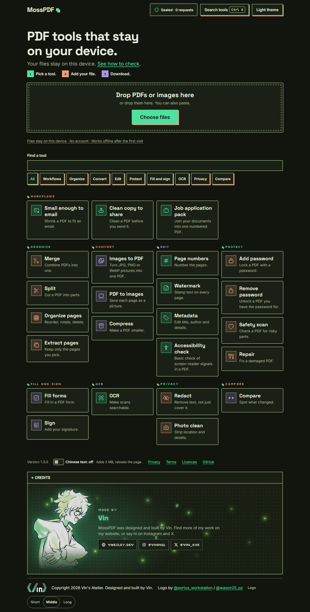
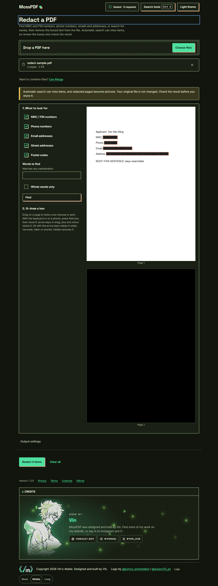
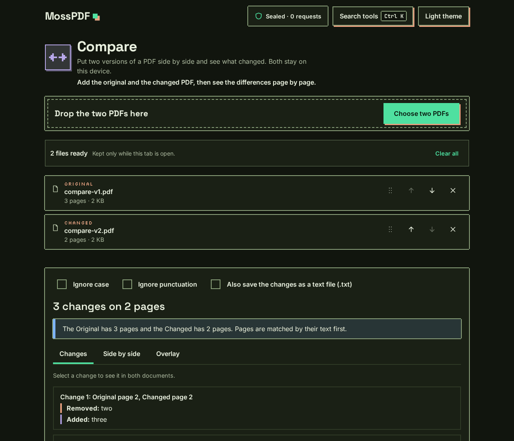
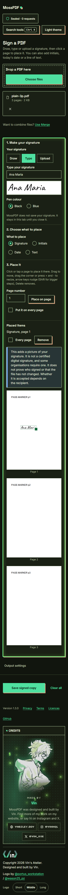

# MossPDF

Free, private PDF tools that run entirely in your browser. Files never leave your device, and the page proves it: after loading, it locks itself against the network and shows a log of the requests it made.

**Live:** https://mosspdf.pages.dev (installable, works offline after the first visit)



## Tools

- **Organize:** merge, split, organize pages (reorder, rotate, delete), extract pages, rotate PDF (quick turn, batch)
- **Convert:** images to PDF, PDF to images, PDF to text, compress
- **Edit:** edit PDF (add text, white-out, highlight, rectangle, line), page numbers, watermark, crop (hides the edges; use Redact to remove content), metadata, accessibility check
- **Protect:** add or remove a password (only with the correct password), safety scan with a cleaned copy, repair
- **Fill and sign:** fill form fields, sign (draw, type or upload; a visual signature, not a certified one)
- **OCR:** make scans searchable (English, Chinese (Simplified), Malay, Tamil)
- **Privacy:** remove text, not just cover it (Singapore NRIC/FIN, phones, emails, addresses, search, hand-drawn boxes), photo clean (EXIF and GPS removal, blur boxes)
- **Compare:** word diff, side by side, pixel overlay, report
- **Workflows:** Small enough to email, Clean copy to share, Job application pack
- **Power features:** command palette (Ctrl/Cmd+K), keyboard shortcuts (?), batch mode with a zip of results

| Redact | Compare | Sign on a phone |
|---|---|---|
|  |  |  |

## How the privacy works

- The site's CSP allows only its own origin. After the engines load, the page adds a stricter CSP that blocks all network access, and the engine workers have none at all.
- The **Sealed** badge lists the requests since the page loaded that the browser reports. The privacy page explains how to check this yourself in DevTools.
- No accounts, analytics, cookies or ads. The browser stores only your theme, logo size, recently used tools, the OCR languages you chose, a small counter for the logo tip and the output setting. Files are never stored. Signatures and initials are never stored unless you choose "Keep on this device"; you can forget them any time.
- See [docs/LEGAL-REVIEW.md](docs/LEGAL-REVIEW.md) for what the app claims and its limits, and [docs/COMPARISON.md](docs/COMPARISON.md) for how it compares with other PDF tools.

## Run it offline from a release

Download `mosspdf-vX.Y.Z.zip` from [Releases](https://github.com/vincentwesley/mosspdf/releases), unzip it, then run `node serve.mjs` inside the folder (Node 18+) and open the address it prints. The bundled server applies the same security headers as the live site.

## Develop

```bash
npm ci --ignore-scripts
npm run pw -- install chromium firefox webkit   # browsers for e2e
npm run dev            # local dev server
npm run check          # typecheck + lint + unit + build
npm run test:e2e       # Playwright, headless, 5 browser projects
npm run release        # after build: release/mosspdf-vX.Y.Z.zip
```

Architecture, decisions and plans live in `docs/` (start with [docs/PLAN.md](docs/PLAN.md)). Large-file timings: [docs/PERF.md](docs/PERF.md). Usability walkthroughs: [docs/USABILITY.md](docs/USABILITY.md).

## Deploy

Cloudflare Pages (https://mosspdf.pages.dev), deployed locally: `npm run deploy`, then `npm run smoke:prod`.

## Secrets and network

No secrets and no third-party network calls at runtime; everything runs in the browser. Provided as is, no warranty.

## Credits

Designed and built by Vin, Vin's Atelier (https://vwesley.dev). Logo by @portus_workstation / @wason25_pz (Instagram); the logo is all rights reserved (see NOTICE.md), not covered by the MIT licence. Third-party components and their licences: [THIRD_PARTY_NOTICES.md](THIRD_PARTY_NOTICES.md).
